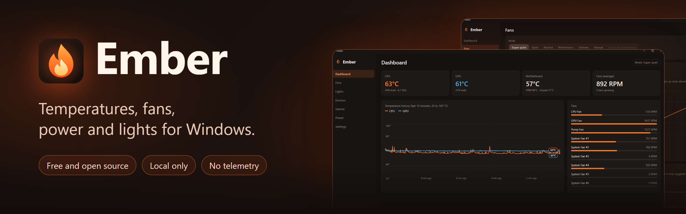
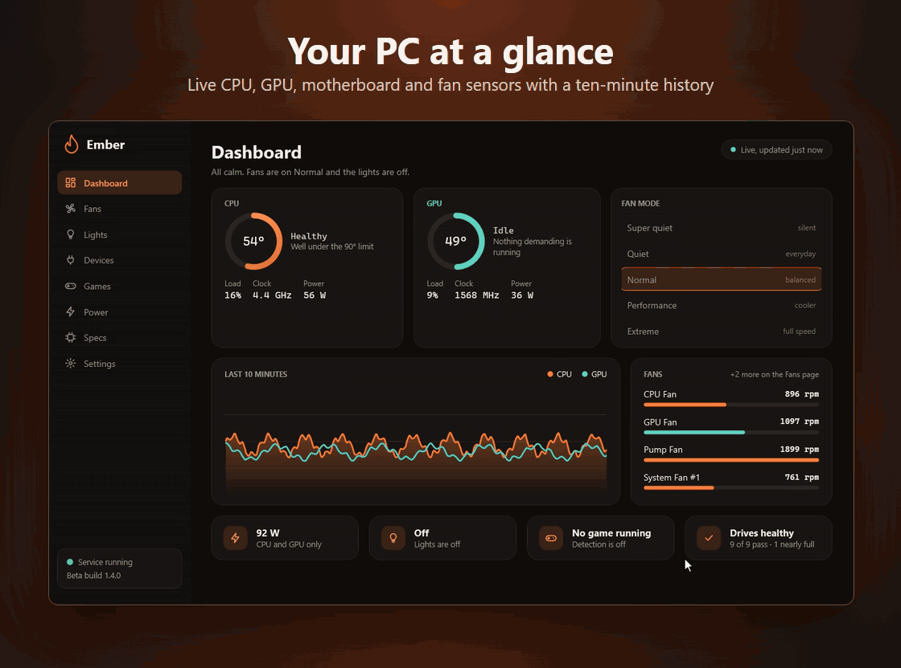
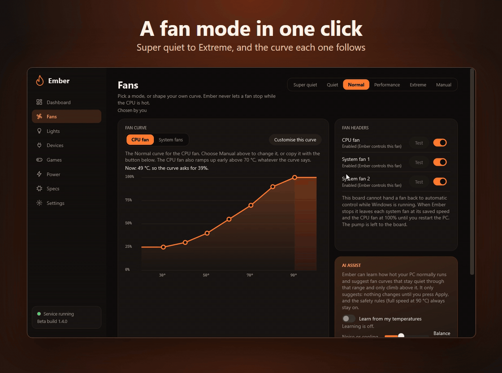
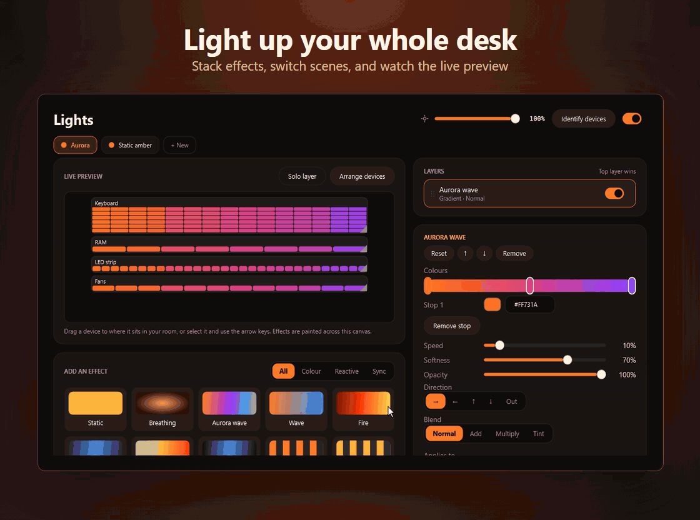
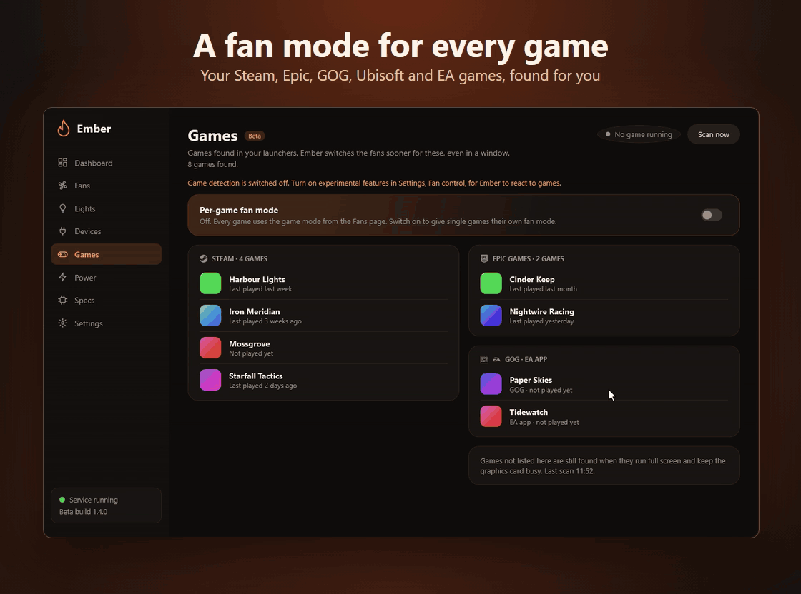
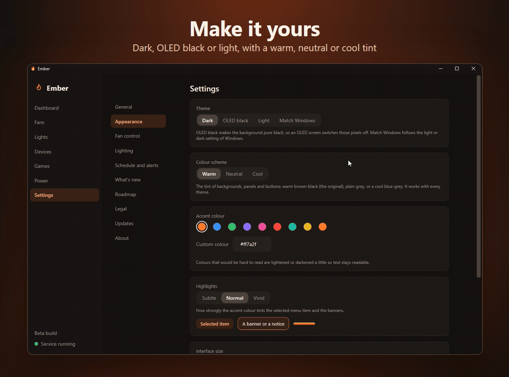

  

<h1 align="center">Ember: temperatures, fans, power and lights for Windows</h1>

<a href="#features">Features</a> · <a href="#tour">Tour</a> · <a href="#install">Install</a> · <a href="#safety">Safety</a> · <a href="#faq">FAQ</a> · <a href="ROADMAP.md">Roadmap</a> · <a href="PRIVACY.md">Privacy</a>

**Ember is a free, open source Windows app that shows your PC's temperatures and power draw, runs your fans on quiet-to-extreme curves, and lights your RGB gear, all from one calm, macOS-style window.** A small background service reads the sensors and writes fan speeds; the app only displays and asks. Nothing leaves your PC.

> [!TIP]
> **Install:** download `Ember-Setup-<version>.exe` from the [latest release](https://github.com/Ol775/ember-pc/releases/latest) · [more options](docs/install.md) · builds marked **Pre-release** are betas

## Two builds

| | **Stable 1.3.0** | **Beta 1.4.0-beta.1** |
|---|---|---|
| **Look** | The classic window | **The new look**: icon sidebar, ring gauges, rounded cards, a live preview on Lights, and the tour below |
| **Lights** | Rename any device, a gradient effect with colour stops, Logitech G keys | The same, plus a layer editor that fits small windows and *Applies to* chips |
| **Also** | Power and Games pages, quieter redraws, a checked update installer | A Specs page with drive health, power cost estimate, schedule and alerts, Stream Deck plugin, GPU fan control |
| **Get it** | [Latest release](https://github.com/Ol775/ember-pc/releases/latest) | [Pre-releases](https://github.com/Ol775/ember-pc/releases), or Settings, Updates, Release channel, Beta |

The pictures on this page show the beta's new look. See the [changelog](CHANGELOG.md) for every change.

## Features

- **Live dashboard** with CPU, GPU, motherboard and fan sensors and a 10-minute history
- **Five fan modes** from Super quiet to Extreme, or your own manual curves, with the safety limits enforced
- **Power draw** for the whole PC, CPU and GPU, measured at the wall with a read-only smart plug
- **RGB lighting** through OpenRGB, Govee, Logitech, Philips Hue and Corsair, with scenes, effects, music and screen sync
- **Game detection** that switches the fans to your game mode (Beta), with game covers and a last-played line on the Games page (beta look)
- **Schedule and alerts** (beta): quiet fans at night, a notice when a part runs hot or a fan stops
- **Dark, OLED black and light**, nine accent colours or your own
- **No telemetry**: nothing is downloaded until you choose it

> [!NOTE]
> Fan speeds are written only for headers you have tested and enabled yourself, and Ember never switches a smart plug. Ember is independent and not affiliated with the hardware brands it works with.

<b>Everything it does</b>

- **Live dashboard.** CPU, GPU, motherboard and fan sensors with a 10-minute temperature history, in Celsius or Fahrenheit.
- **Fan modes.** **Super quiet**, **Quiet**, **Normal**, **Performance** and **Extreme** curves, switched with one click, or draw your own **manual curves** for the CPU fan and the system fans, with the safety limits enforced.
- **Safety first.** At 90 °C every controlled fan goes to 100%, a lost sensor sends fans to 100%, and a separate **watchdog** service restores safe speeds if Ember stops responding. Nothing is written to a fan header until you have tested and enabled it yourself.
- **Power.** What your PC draws: the whole PC, the CPU, the graphics card, the motherboard and the rest, and any other plugs, each with the live watts, a graph, the average, the peak and the energy used. Link a **smart plug** (Meross MSS310 or MSS315, Tapo P110 or P115, Kasa KP115 or HS110, Shelly plugs with a power meter) and mark it as your PC's plug to measure the real draw from the wall. Plugs are **read only**: Ember never switches one.
- **Games.** Ember scans your **Steam, Epic Games, GOG, Ubisoft Connect and EA app** libraries (on start, when you open the page, and on **Scan now**) and switches the fans to your game mode when one of those games runs, even in a window. Give single games their own fan mode if you want to (off by default). Game detection is **Beta** and sits behind the Experimental switch.
- **Lighting.** Drives PC devices through **OpenRGB** (bundled), **Govee** lamps over your LAN (or the Govee cloud with your own API key), **Logitech** G keyboards through G HUB, **Philips Hue** lights through the bridge on your network (no Hue account) and **Corsair** devices through iCUE. **WiZ**, **LIFX**, **Yeelight** and **Kasa** bulbs are found on your network with no account (Beta). **Razer Chroma**, **Nanoleaf** panels, **Meross** bulbs and **Tapo** bulbs are marked **Beta**: written and tested in software but not yet tried on enough real devices.
- **Scenes and effects.** Stack effects with blend modes, paint single LEDs, give any device its own colours, and save it all as scenes. Music-reactive lights and **screen sync** (read straight from the graphics card, including HDR desktops) are built in.
- **Specs (beta).** Your processor, graphics card, memory, drives (with S.M.A.R.T. health), displays and Windows version on one page, with a button to copy them for a support request. It never includes the PC name or your user name.
- **Schedule and alerts (beta).** Switch the fan mode or the lights for a time window, and get a Windows notice when the CPU or graphics card stays too hot or a fan stops while the PC is warm.
- **Conflict detection.** Warns by name if NZXT CAM, MSI Center, Fan Control, iCUE or similar is running, and can close them for you.
- **Make it yours.** Dark, **OLED black**, light or match Windows; a warm, neutral or cool colour scheme; nine accent colours or your own `#rrggbb`; interface size; and where the window opens.
- **Updates.** Ember checks GitHub for a newer release and asks whether to update now, later, or skip that version. **Update now** downloads the installer, checks it against the release checksum and updates in place. Nothing is downloaded until you choose it.
- **Stream Deck plugin (beta builds).** Keys for lighting scenes, lights on and off, brightness, fan modes, opening Ember, and live CPU and GPU temperature and fan speed.
- **Private by design.** No accounts, no telemetry. The only network use is what you switch on. See [PRIVACY.md](PRIVACY.md).

## Tour

### Your PC at a glance

### A fan mode in one click

### Light up your whole desk

### A fan mode for every game

### Power at the wall

### Make it yours

## Install

**Requirements:** Windows 10 or 11 (x64) and administrator rights to install the services and the driver. The installer adds the .NET 8 runtime if it is missing.

1. Download `Ember-Setup-<version>.exe` from the [releases page](https://github.com/Ol775/ember-pc/releases). The release marked **Latest** is the production build; releases marked **Pre-release** are betas with features still being proven.
2. Run it, read and accept the Terms of Use, and follow the pages. It adds the services and downloads the signed PawnIO driver, which it checks before it runs.
3. Windows will show an "unknown publisher" warning because the installer is not code-signed yet. You can check the file against the `.sha256` next to it: `Get-FileHash Ember-Setup-<version>.exe`.

Building from source, scripted installs and silent install options are in [docs/install.md](docs/install.md).

<b>First launch</b>

1. Open **Fans**, test one **System Fan** header, then enable it. Nothing is written to a fan header before you do. Close any other fan-control program first.
2. Open **Power** and, if you have a Meross or Tapo smart plug that measures energy, link it and mark it as your PC's plug. Save the account first in Settings, Meross or Tapo.
3. Open **Games** to see the games Ember found. Switch on Experimental features (Settings, Fan control) if you want game detection to change the fan mode.

<b>Updating</b>

Ember checks for updates when it starts and every few hours, and asks before it does anything: **Update now**, **Remind me later** or **Skip this version**. Settings, Updates has **Check now** and the **Release channel** (Stable or Beta). Updates are verified like this:

1. Ember asks GitHub for the newest release of this repository, and for nothing else.
2. **Update now** downloads the installer and the `.sha256` file published next to it.
3. The installer is checked against the checksum before it runs. If they do not match it is thrown away and nothing is installed. A checksum proves the file is the one that was released, not who made it.
4. Nothing is downloaded or installed until you press the button.

## Safety

Fan speeds are written only by the Ember service, through LibreHardwareMonitorLib and the PawnIO driver, and only for headers you have tested and enabled. The app never touches hardware.

- At 90 °C on any source every controlled fan goes to 100% (released at 85 °C). A missing or stale sensor sends the affected fans to 100%.
- Fans never go below a floor: system fans 20%, CPU fan 30%, GPU fan 30%. The CPU fan ramps early: at least 60% from 70 °C, 85% from 75 °C and 100% from 80 °C.
- The pump is left entirely to the board.
- When the service stops, each system fan is left at the speed it had before Ember first touched it and the CPU fan at 100%. Ember never calls the library's restore call, because it left a fan stuck low on the author's MSI B550-A PRO. Restarting the PC returns the board to automatic control.

How the service is locked down, and how to report a problem privately: [SECURITY.md](SECURITY.md).

## FAQ

<b>Is it safe to run?</b>

Fan control has unit tests and has been checked on one real PC, and the safety rules above are enforced in the service. The production build holds what has been checked on real hardware, with Razer Chroma, Nanoleaf, Meross, Tapo and game detection marked Beta. Either way, test one header at a time and watch your temperatures.

<b>Does it work on my motherboard?</b>

It is built and tested on an MSI B550-A PRO (NCT6687D). Other chips supported by LibreHardwareMonitor may work; [docs/windows-verification.md](docs/windows-verification.md) shows what has been verified. It needs the PawnIO driver for motherboard sensors and fan headers; see [why PawnIO](docs/architecture.md#why-pawnio).

<b>Why does the Power page say my motherboard has no sensor?</b>

No motherboard reports how much power it uses, and software cannot read it from the chip. CPU and GPU report their own watts. For the rest (board, memory, drives, fans, power supply losses) Ember uses a smart plug on your PC: wall draw minus CPU and GPU. Without a plug it shows CPU and GPU only and says so, rather than inventing a number.

<b>Will Ember switch my smart plugs?</b>

No. It only asks a plug what it is drawing. Meross is used for bulbs and light strips only, and plugs, hubs and thermostats are never controlled.

<b>What does it need to see my Meross or Tapo devices?</b>

The same Wi-Fi as the PC. Meross signs in once to list your devices and learn their key, then talks to them directly. Tapo needs your Tapo account email and password, kept in Windows Credential Manager and sent only to your devices on the local network; switch on **Third-Party Compatibility** for them in the Tapo app if they are not found.

<b>How does game detection decide?</b>

A game from your Steam, Epic, GOG, Ubisoft Connect or EA app library counts after 4 seconds at 20% GPU load, windowed or full screen. Any other program counts when it runs full screen and keeps the GPU at 50% or more for 10 seconds. Mark a wrong guess as not a game. It is behind **Experimental features** and is marked Beta.

<b>Why are some of my fans at 0 RPM in Super quiet?</b>

Some fans stop below about 20% speed. Pick Quiet, or use Manual to set a higher minimum.

<b>Can I use it with SignalRGB or NZXT CAM?</b>

Not at the same time on the same devices (Logitech G HUB, SignalRGB and Ember all want to set the lighting; only one should be active at a time). Ember warns you about fan-control programs and can close them.

<b>Does it send data anywhere?</b>

Not on its own: no accounts and no telemetry, and the only network use is what you switch on. See [PRIVACY.md](PRIVACY.md).

## Help and project

| | |
|---|---|
| **Found a bug?** | Open an [issue](https://github.com/Ol775/ember-pc/issues) and attach the diagnostic report (Settings, About, **Copy diagnostic report**). It holds versions, what each integration found, device names and a scrubbed recent log, and no passwords or keys; read it before you post it. Security problems go through [SECURITY.md](SECURITY.md), not a public issue. |
| **Docs** | [CHANGELOG](CHANGELOG.md) · [ROADMAP](ROADMAP.md) · [install options](docs/install.md) · [how Ember is put together](docs/architecture.md) · [known issues](docs/known-issues.md) · [all docs](docs/README.md) |
| **Contributing** | Issues and pull requests are welcome: [CONTRIBUTING.md](CONTRIBUTING.md), [code of conduct](CODE_OF_CONDUCT.md). Want to test betas? See the [beta testing guide](docs/beta-testing.md). |
| **Licence** | MIT, see [LICENSE](LICENSE), plus the [Terms of Use](TERMS.md) and [Privacy notice](PRIVACY.md). Third-party parts are in [THIRD-PARTY.md](THIRD-PARTY.md): [LibreHardwareMonitorLib](https://github.com/LibreHardwareMonitor/LibreHardwareMonitor) (MPL-2.0, used unmodified), [OpenRGB](https://openrgb.org) (GPL-2.0, bundled as a separate program) and PawnIO by namazso (a separate driver, installed separately). |

Ember is an independent project by Ol775. It is not affiliated with, endorsed by or sponsored by NZXT, MSI, Govee, Logitech, Philips Hue (Signify), Nanoleaf, Razer, OpenRGB, SignalRGB, Noctua, AMD, Intel or NVIDIA. Product names are trademarks of their respective owners. Use at your own risk: you are responsible for your hardware.
