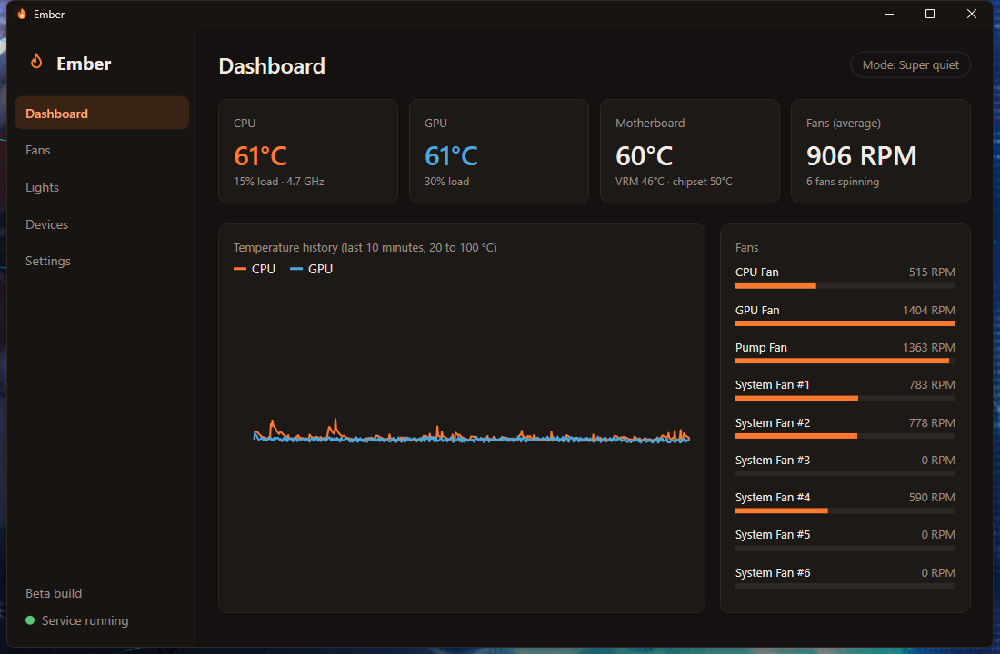
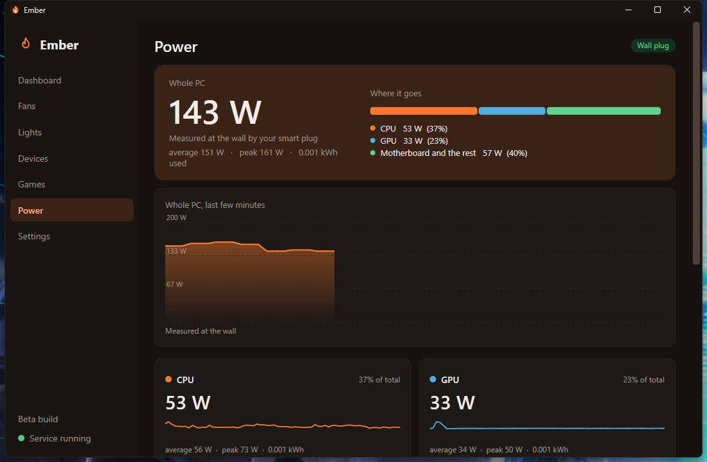
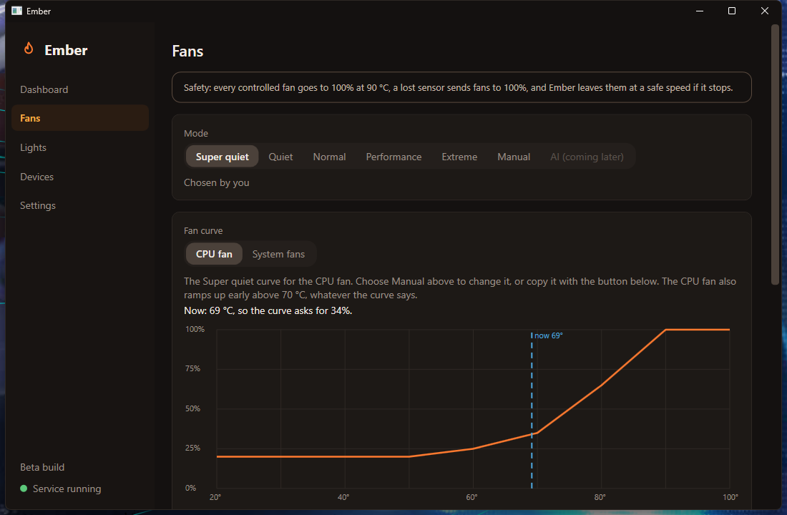
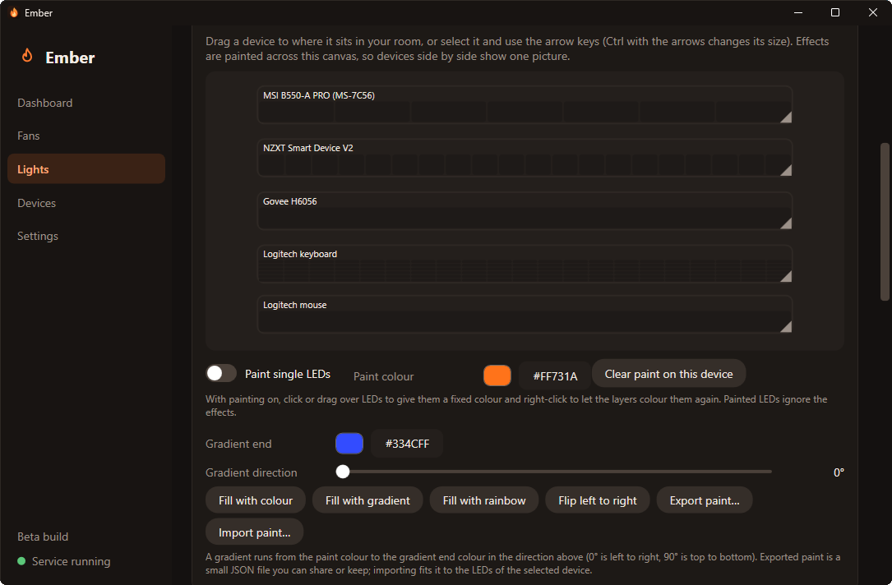
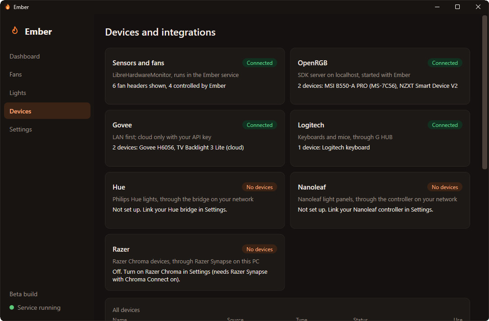
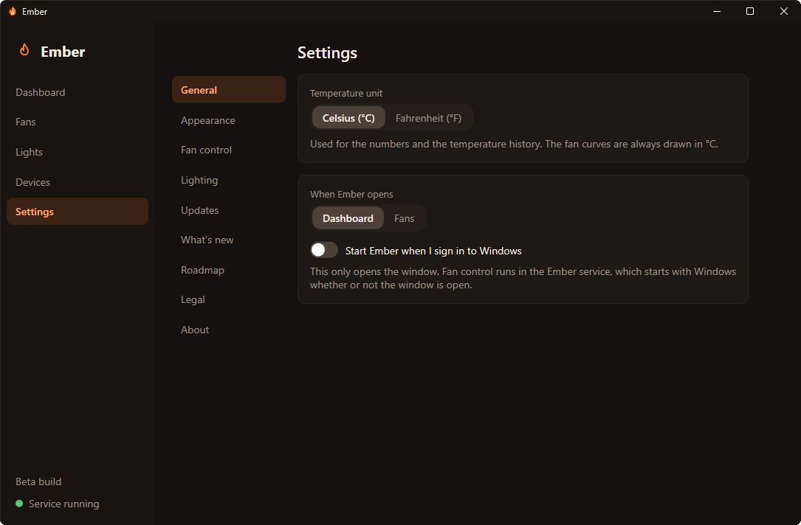
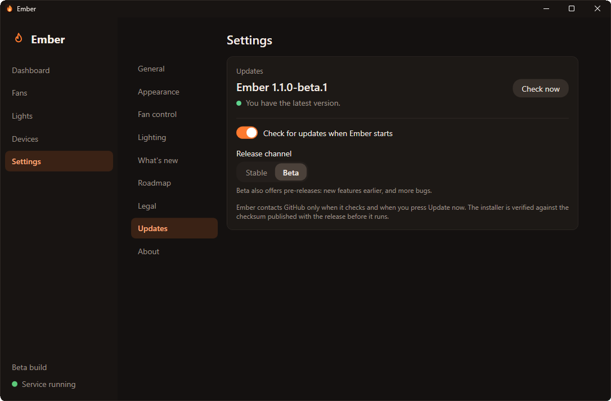
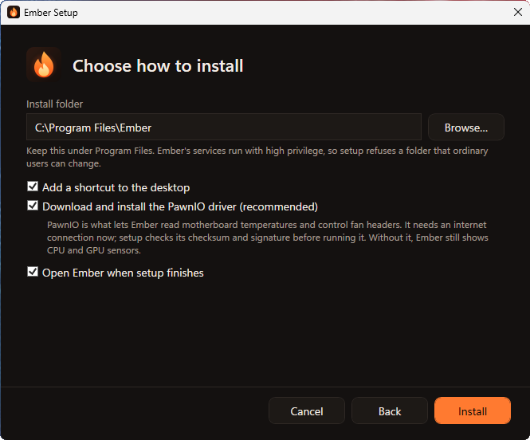

<p align="center">
  
</p>

# Ember: temperatures, fans, power and lights for Windows

<p align="center">
  
  
  
  
  
  
</p>

**Ember is a free, open source Windows app that shows your PC's temperatures and power draw, runs your fans on quiet-to-extreme curves, and lights your RGB gear, all from one calm, macOS-style window.** A small background service reads the sensors and writes fan speeds; the app only displays and asks. Nothing leaves your PC.

<p align="center">
  <a href="docs/images/dashboard.png"></a>
</p>

## Features

- **Live dashboard.** CPU, GPU, motherboard and fan sensors with a 10-minute temperature history, in Celsius or Fahrenheit.
- **Fan modes.** **Super quiet**, **Quiet**, **Normal**, **Performance** and **Extreme** curves, switched with one click, or draw your own **manual curves** for the CPU fan and the system fans, with the safety limits enforced.
- **Safety first.** At 90 °C every controlled fan goes to 100%, a lost sensor sends fans to 100%, and a separate **watchdog** service restores safe speeds if Ember stops responding. Nothing is written to a fan header until you have tested and enabled it yourself.
- **Power.** What your PC draws: the whole PC, the CPU, the graphics card, the motherboard and the rest, and any other plugs, each with the live watts, a graph, the average, the peak and the energy used. Link a **smart plug** (Meross MSS310 or MSS315, Tapo P110 or P115) and mark it as your PC's plug to measure the real draw from the wall. Plugs are **read only**: Ember never switches one.
- **Games.** Ember scans your **Steam, Epic Games, GOG, Ubisoft Connect and EA app** libraries (on start, when you open the page, and on **Scan now**) and switches the fans to your game mode when one of those games runs, even in a window. Give single games their own fan mode if you want to (off by default). Game detection is **Beta** and sits behind the Experimental switch.
- **Lighting.** Drives PC devices through **OpenRGB** (bundled), **Govee** lamps over your LAN (or the Govee cloud with your own API key), **Logitech** G keyboards through G HUB, **Philips Hue** lights through the bridge on your network (no Hue account) and **Corsair** devices through iCUE. **Razer Chroma**, **Nanoleaf** panels, **Meross** bulbs and **Tapo** bulbs are marked **Beta**: written and tested in software but not yet tried on enough real devices.
- **Scenes and effects.** Stack effects with blend modes, paint single LEDs, give any device its own colours, and save it all as scenes. Music-reactive lights and **screen sync** (read straight from the graphics card, including HDR desktops) are built in.
- **Conflict detection.** Warns by name if NZXT CAM, MSI Center, Fan Control, iCUE or similar is running, and can close them for you.
- **Make it yours.** Dark, **OLED black**, light or match Windows; a warm, neutral or cool colour scheme; nine accent colours or your own `#rrggbb`; interface size; and where the window opens.
- **Updates.** Ember checks GitHub for a newer release and asks whether to update now, later, or skip that version. **Update now** downloads the installer, checks it against the release checksum and updates in place. Nothing is downloaded until you choose it.
- **Stream Deck plugin (beta builds).** Keys for lighting scenes, lights on and off, brightness, fan modes, opening Ember, and live CPU and GPU temperature and fan speed.
- **Private by design.** No accounts, no telemetry. The only network use is what you switch on. See [PRIVACY.md](PRIVACY.md).

## Screenshots

<p align="center">
  <a href="docs/images/power.png"></a>
</p>
<p align="center">
  <a href="docs/images/fans.png"></a>
  <a href="docs/images/lights.png"></a>
</p>
<p align="center">
  <a href="docs/images/fan-headers.png"></a>
  <a href="docs/images/settings.png"></a>
</p>
<p align="center">
  <a href="docs/images/updates.png"></a>
  <a href="docs/images/installer.png"></a>
</p>

## Requirements

- Windows 10 or 11 (x64)
- .NET 8 Desktop Runtime (the installer adds it if it is missing)
- Administrator rights to install the services and the driver (the app itself runs as a normal user)
- The **PawnIO** driver, for motherboard temperatures and fan headers. Without it, CPU and GPU temperatures still work and the app explains how to install it.

## Install

Ember comes in two kinds of release. The **production build** (for example 1.2.0) holds what has been checked on real hardware: sensors and fans, the Power page, OpenRGB, Govee, Logitech, Philips Hue and Corsair. A few things in it are marked **Beta** because they are written and tested but not yet proven on enough real devices: Razer Chroma, Nanoleaf, Meross, Tapo and game detection. The **beta builds** (for example 1.3.0-beta.1, marked as pre-releases on the releases page) add what is not in production yet: GPU fan control, the Stream Deck plugin and the roadmap page. Download the one you want from the [releases page](https://github.com/Ol775/ember-pc/releases), or switch from inside Ember: Settings, Updates, Release channel moves the installation to the newest Stable or Beta version after you confirm.

**Option 1: installer (easiest).** Download `Ember-Setup-<version>.exe` from the [releases page](https://github.com/Ol775/ember-pc/releases), run it, read and accept the Terms of Use, and follow the pages. It installs the .NET 8 and Visual C++ runtimes if your PC lacks them, adds the services, and downloads the PawnIO driver (checked before it runs). Ember appears in the Start menu and under Installed apps in Windows Settings, where you can also remove it. Windows will show an "unknown publisher" warning because the installer is not code-signed yet. For a scripted install: `Ember-Setup-<version>.exe /S /ACCEPT` (add `/D=C:\Path\Ember` for another folder, `/NODESKTOP`, `/NOPAWNIO`; `/ACCEPT` says you have read TERMS.md).

**Option 2: from source.** Build the release folder once, then install it with one script.

**Quick install (recommended).** In PowerShell, from the repository folder:

```powershell
scripts\build-release.ps1          # fetches OpenRGB and the Microsoft runtimes, publishes everything, writes dist\Ember-<version>.zip and dist\Ember-Setup-<version>.exe
```

Then, in an **elevated** PowerShell, from the unzipped `dist\Ember-<version>` folder:

```powershell
scripts\install-ember.ps1          # installs to C:\Program Files\Ember, adds both services and a Start Menu shortcut
```

Run the same script again to upgrade; your settings are kept. An installed Ember can also update itself: Settings, Updates, Check now, then Update now. `scripts\uninstall-ember.ps1` removes it (add `-RemoveFiles` to delete the program files too).

**Manual install** (the steps the script follows):
1. Fetch the bundled OpenRGB (checks a pinned SHA-256) and publish:

   ```powershell
   scripts\fetch-openrgb.ps1
   dotnet publish src/Ember.Service  -c Release -r win-x64 --self-contained false -o publish\service
   dotnet publish src/Ember.Watchdog -c Release -r win-x64 --self-contained false -o publish\watchdog
   dotnet publish src/Ember.App      -c Release -r win-x64 --self-contained false -o publish\app
   ```

2. In an elevated PowerShell, install PawnIO (downloads the official release and checks its SHA-256 and signature):

   ```powershell
   scripts\install-pawnio.ps1
   ```

3. Copy `publish\service\*` to a folder only administrators can write, such as `C:\Program Files\Ember\`, then, elevated:

   ```powershell
   scripts\install-service.ps1 -ExePath "C:\Program Files\Ember\Ember.Service.exe"
   ```

   The service runs as LocalSystem, so the script refuses folders that normal users can write.

4. Copy `publish\watchdog\*` to `C:\Program Files\Ember\Watchdog\`, then, elevated:

   ```powershell
   scripts\install-watchdog.ps1 -ExePath "C:\Program Files\Ember\Watchdog\Ember.Watchdog.exe"
   ```

5. Run `publish\app\Ember.App.exe` as your normal user. Open the Fans page, test one System Fan header, then enable it. Close any other fan-control program first.

If you install PawnIO after the service, run `Restart-Service EmberService`. To remove the service, run `scripts\uninstall-service.ps1` (elevated).

### First launch

1. Windows asks for permission to install the services and the driver, and shows an "unknown publisher" warning, because the installer is not code-signed yet. Check the file against its `.sha256` on the releases page first if you like (see below).
2. Open **Fans**, test one **System Fan** header, then enable it. Nothing is written to a fan header before you do. Close any other fan-control program first.
3. Open **Power** and, if you have a Meross or Tapo smart plug that measures energy, link it in the Smart plugs panel and mark it as your PC's plug. First save the account in Settings, Meross or Tapo.
4. Open **Games** to see the games Ember found, and switch on Experimental features (Settings, Fan control) if you want game detection to change the fan mode.

### Updating

Ember checks for updates when it starts and every few hours, and asks before it does anything: **Update now**, **Remind me later** or **Skip this version**. Settings, Updates has **Check now** and the **Release channel** (Stable or Beta). If **Restart services** is ever needed after an update, it is a button on the Devices page, and Ember keeps running.

### Reporting bugs

Open an [issue](https://github.com/Ol775/ember-pc/issues) and attach the diagnostic report: Settings, About, **Copy diagnostic report**. It holds versions, what each integration found, device names and a scrubbed recent log; it does not hold passwords or keys. Read it before you post it, and remove any device name you would rather not share.

## Build and test

```powershell
dotnet build Ember.sln
dotnet test
```

The WPF app and the service's hardware, pipe-security and install code are only verified on Windows.

## Safety

Fan speeds are written only by the Ember service, through LibreHardwareMonitorLib and the PawnIO driver, and only for headers you have tested and enabled. The app never touches hardware.

- At 90 °C on any source every controlled fan goes to 100% (released at 85 °C). A missing or stale sensor sends the affected fans to 100%.
- Fans never go below a floor: system fans 20%, CPU fan 30%, GPU fan 30%. The CPU fan ramps early: at least 60% from 70 °C, 85% from 75 °C and 100% from 80 °C.
- The pump is left entirely to the board.
- When the service stops, each system fan is left at the speed it had before Ember first touched it and the CPU fan at 100%. Ember never calls the library's restore call, because it left a fan stuck low on the author's MSI B550-A PRO. Restarting the PC returns the board to automatic control.

See [SECURITY.md](SECURITY.md) for how the service is locked down and how to report a problem.

## Why PawnIO

Motherboard sensors and fan headers sit behind port I/O that user mode cannot reach, so a kernel driver is needed. Many monitoring tools use WinRing0, which is vulnerable (CVE-2020-14979: any local user can read and write physical memory) and is flagged by Microsoft Defender. Ember uses the signed PawnIO driver instead. Details: [docs/driver-research.md](docs/driver-research.md).

## FAQ

**Is it safe to run?** Fan control has unit tests and has been checked on one real PC, and the safety rules above are enforced in the service. The production build holds what has been checked on real hardware, with Razer Chroma, Nanoleaf, Meross, Tapo and game detection marked Beta; the beta builds add features still being tested. Either way, test one header at a time and watch your temperatures.

**Why does the Power page say my motherboard has no sensor?** No motherboard reports how much power it uses itself, and software cannot read it from the chip. CPU and GPU report their own watts. For the rest (board, memory, drives, fans, power supply losses) Ember uses a smart plug on your PC: wall draw minus CPU and GPU. Without a plug it shows CPU and GPU only and says so, rather than inventing a number.

**Will Ember switch my smart plugs?** No. It only asks a plug what it is drawing. Meross is used for bulbs and light strips only, and plugs, hubs and thermostats are never controlled.

**What does it need to see my Meross or Tapo devices?** The same Wi-Fi as the PC. Meross signs in once to list your devices and learn their key, then talks to them directly. Tapo needs your Tapo account email and password, kept in Windows Credential Manager and sent only to your devices on the local network; switch on **Third-Party Compatibility** for them in the Tapo app if they are not found.

**How does game detection decide?** A game from your Steam, Epic, GOG, Ubisoft Connect or EA app library counts after 4 seconds at 20% GPU load, windowed or full screen. Any other program counts when it runs full screen and keeps the GPU at 50% or more for 10 seconds. Mark a wrong guess as not a game. It is behind **Experimental features** and is marked Beta.

**Does it work on my motherboard?** It is built and tested on an MSI B550-A PRO (NCT6687D). Other chips supported by LibreHardwareMonitor may work; [docs/windows-checklist.md](docs/windows-checklist.md) shows what has been verified.

**Why are some of my fans at 0 RPM in Super quiet?** Some fans stop below about 20% speed. Pick Quiet, or use Manual to set a higher minimum.

**Does it send data anywhere?** Not on its own: no accounts and no telemetry, and the only network use is what you switch on. See [PRIVACY.md](PRIVACY.md).

**Can I use it with SignalRGB or NZXT CAM?** Not at the same time on the same devices (Logitech G HUB, SignalRGB and Ember all want to set the lighting; only one should be active at a time). Ember warns you about fan-control programs and can close them.

**Where is the roadmap?** See [ROADMAP.md](ROADMAP.md), and [CHANGELOG.md](CHANGELOG.md) for what changed in each version. The changelog is also inside the app, in Settings; the roadmap page is in the beta builds.

## Security

The service runs as LocalSystem and is locked down; see [SECURITY.md](SECURITY.md) to report a problem.

### How updates are verified

1. Ember asks GitHub for the newest release of this repository, and for nothing else.
2. **Update now** downloads the installer from that release and the `.sha256` file published next to it.
3. The installer is checked against the checksum before it runs. If they do not match it is thrown away and nothing is installed. A checksum proves the file is the one that was released, not who made it; the installer is not code-signed yet.
4. Nothing is downloaded or installed until you press the button. You can also download the installer yourself and compare the checksum by hand: `Get-FileHash Ember-Setup-<version>.exe`.

## Contributing

Want to help test the beta builds? See the [beta testing guide](docs/BETA-TESTING.md). Issues and pull requests are welcome. See [CONTRIBUTING.md](CONTRIBUTING.md) and the [code of conduct](CODE_OF_CONDUCT.md).

## Licence and terms

MIT. See [LICENSE](LICENSE). Using Ember is also covered by the [Terms of Use](TERMS.md) and the [Privacy notice](PRIVACY.md). Third-party components are listed in [THIRD-PARTY.md](THIRD-PARTY.md): [LibreHardwareMonitorLib](https://github.com/LibreHardwareMonitor/LibreHardwareMonitor) (MPL-2.0, used unmodified), [OpenRGB](https://openrgb.org) (GPL-2.0, bundled as a separate program) and PawnIO by namazso (a separate driver, installed separately).

## Disclaimer

Ember is an independent project by Ol775. It is not affiliated with, endorsed by or sponsored by NZXT, MSI, Govee, Logitech, Philips Hue (Signify), Nanoleaf, Razer, OpenRGB, SignalRGB, Noctua, AMD, Intel or NVIDIA. Product names are trademarks of their respective owners. Use at your own risk: you are responsible for your hardware.
